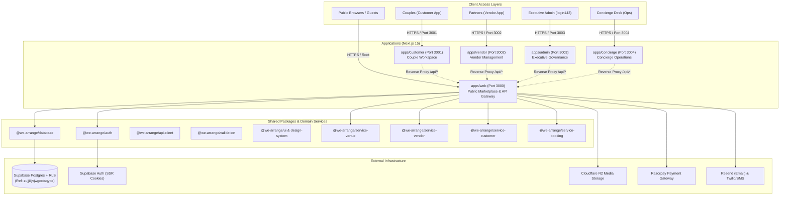

# We Arrange (YMWA) — Final Monorepo & System Architecture

This document defines the production architecture, application responsibilities, data flow, security model, and integration contracts for the We Arrange (YMWA) luxury wedding marketplace platform.

---

## 1. System Overview

We Arrange (YMWA) is structured as a unified **Turborepo** monorepo managed with **pnpm**, containing five distinct Next.js 15 applications, eleven shared packages, and four domain service libraries (20 workspace packages in total).



---

## 2. Monorepo Responsibility Matrix

### 2.1 The Five Applications

| Application | Path | Port | Target Domain | Core Responsibilities |
| :--- | :--- | :--- | :--- | :--- |
| **`apps/web`** | `apps/web` | `3000` | `youmarriagewearrange.com` | **Public Discovery & API Gateway**: Public catalog (venues, vendors, inspiration, real weddings), informational pages (about, contact, terms, privacy, faq), customer overview dashboard, central REST API route handlers (`/api/*`), webhook receivers, and server-side SSR rendering. |
| **`apps/customer`** | `apps/customer` | `3001` | `customer.youmarriagewearrange.com` | **Dedicated Customer Experience**: Planning workspace, saved venue/vendor shortlists, comparison sheets, inquiry tracking, quote review, and booking management. |
| **`apps/vendor`** | `apps/vendor` | `3002` | `vendor.youmarriagewearrange.com` | **Vendor Operations**: Onboarding, verification badge status, service package management, pricing cards, photo/video gallery management, availability calendar, inquiry inbox, and booking confirmation. |
| **`apps/admin`** | `apps/admin` | `3003` | `admin.youmarriagewearrange.com` | **Executive Governance**: Secret staff authentication (`/admin/login143`), KPI metric analytics, user role & permission management, vendor verification review, venue curation, review moderation, and system reports. |
| **`apps/concierge`** | `apps/concierge` | `3004` | `concierge.youmarriagewearrange.com` | **Concierge Operations**: High-touch lead queue, site visit scheduler, custom quote preparation, side-by-side venue comparison sheet builder, and client communication. |

### 2.2 Shared Workspace Packages

| Package | Purpose | Consumed By |
| :--- | :--- | :--- |
| **`@we-arrange/auth`** | Supabase browser and SSR client factories, environment validation, RBAC helpers, and session typing. | All 5 applications |
| **`@we-arrange/database`** | Typed Supabase client access (`database.types.ts`), server-only client protection (`"server-only"` guard), query repository, and migration schemas. | `apps/web`, services, satellite middleware |
| **`@we-arrange/validation`** | Canonical Zod schemas for auth, catalog filtering, inquiries, quotes, bookings, reviews, and uploads. | All apps and services |
| **`@we-arrange/api-client`** | Type-safe HTTP client with automatic session token propagation and unified error envelopes. | All apps |
| **`@we-arrange/ui`** | Reusable design components: button, dialog, input, card, badge, tabs, table, and skeleton loaders. | All apps |
| **`@we-arrange/design-system`** | Central token definitions: imperial maroon, warm gold, alabaster cream, typography scales, and motion tokens. | All apps & `@we-arrange/ui` |
| **`@we-arrange/utils`** | Common formatting utilities: currency (INR), date formatting, string slugification, and cn class merging. | All apps and packages |
| **`@we-arrange/types`** | Shared domain entity interfaces (Venue, Vendor, Booking, Quote, UserProfile, Role). | All apps and packages |

### 2.3 Domain Services

| Service | Path | Ownership |
| :--- | :--- | :--- |
| **`@we-arrange/service-venue`** | `services/venue` | Venue search, filtering, pricing calculations, and capacity queries. |
| **`@we-arrange/service-vendor`** | `services/vendor` | Vendor catalog queries, category indexing, and profile enrichment. |
| **`@we-arrange/service-customer`** | `services/customer` | Customer profile management, favorites/saved store, and inquiry creation. |
| **`@we-arrange/service-booking`** | `services/booking` | End-to-end booking lifecycle, quotes, comparisons, payment intent generation, and refunds. |

---

## 3. Reverse-Proxy & API Architecture

To prevent duplicate API implementations and eliminate CORS complexity, all satellite applications (`apps/customer`, `apps/vendor`, `apps/admin`, `apps/concierge`) implement Next.js rewrites:

```typescript
// apps/*/next.config.ts
const API_ORIGIN = (
  process.env.NEXT_PUBLIC_API_BASE_URL ||
  process.env.NEXT_PUBLIC_SITE_URL ||
  "http://localhost:3000"
).replace(/\/+$/, "");

export default {
  async rewrites() {
    return [
      {
        source: "/api/:path*",
        destination: `${API_ORIGIN}/api/:path*`,
      },
    ];
  },
};
```

### Architectural Benefits:
1. **Single Source of Truth**: All business logic, database transactions, RLS enforcement, and external webhooks reside exclusively in `apps/web/app/api/`.
2. **Zero CORS Friction**: Satellite browsers make requests to their own origin (e.g. `https://customer.youmarriagewearrange.com/api/bookings`), which Next.js server proxies upstream to `apps/web`.
3. **Cookie Forwarding**: Server-to-server proxies automatically forward incoming `Cookie` and `Authorization` headers.

---

## 4. Domain & Cookie Architecture

### Recommended Production Domain Strategy: Subdomains under Single Apex Domain
- **Main Apex**: `youmarriagewearrange.com` (and `www.youmarriagewearrange.com`) -> `apps/web`
- **Customer Subdomain**: `customer.youmarriagewearrange.com` -> `apps/customer`
- **Vendor Subdomain**: `vendor.youmarriagewearrange.com` -> `apps/vendor`
- **Admin Subdomain**: `admin.youmarriagewearrange.com` -> `apps/admin`
- **Concierge Subdomain**: `concierge.youmarriagewearrange.com` -> `apps/concierge`

### Cookie Sharing Specification
Under RFC 6265, cookies can be shared across all subdomains of a parent domain by explicitly configuring the cookie `domain` attribute:
```
Set-Cookie: sb-access-token=...; Domain=.youmarriagewearrange.com; Path=/; Secure; HttpOnly; SameSite=Lax
```
- **In Production**: Set `COOKIE_DOMAIN=.youmarriagewearrange.com` in environment variables across all 5 applications.
- **In Local Development**: Leave `COOKIE_DOMAIN` unset. On `localhost`, browsers do not isolate cookies by port number; cookies set by port 3000 are naturally accessible on ports 3001, 3002, 3003, and 3004.
- **Disjoint Domains (if ever used)**: If applications are deployed on unrelated apex domains (e.g. `ymwa.in` vs `youmarriagewearrange.com`), the browser security model prohibits cross-domain cookies. In that architecture, each app must authenticate independently against Supabase Auth, or utilize token exchange redirect flows.

---

## 5. Security & Authentication Model

1. **Authentication Engine**: Supabase Auth (GoTrue) handling email/password, OTP, and session refresh.
2. **Session Persistence**: HTTP-only, Secure, SameSite=Lax cookies managed via `@supabase/ssr`.
3. **Authorization & RBAC**:
   - Database tables `public.users` (status `Active`, `Suspended`), `public.admins` (status `active`, `inactive`), `public.roles`, and `public.permissions`.
   - Middleware boundaries verify active status on every request.
   - Server-side route handlers enforce `assertAdminOrStaff()` or `assertUserRole()`.
4. **Data Isolation (Postgres RLS)**:
   - 100% of public tables have Row-Level Security enabled.
   - Strict ownership isolation ensures customers can only read/mutate their own inquiries, bookings, and profiles.
   - Vendors can only modify their own listings and view bookings targeting their catalog items.
5. **Secret Protection**:
   - `packages/database/src/clients.ts` is guarded with `import "server-only";` and runtime assertions.
   - Zero production secrets are bundled into client code.

---

## 6. Monorepo Hygiene & Legacy Cleanliness

- **No Root `src/` Usage**: The historical root `src/` directory is legacy pre-monorepo code. All active application compilation resolves via `apps/*/tsconfig.json` with `@/* -> ./*`. Vitest configuration explicitly maps `@ -> apps/web`.
- **No Unused Dependencies**: All 20 packages maintain strictly declared `pnpm` workspace dependencies.
- **Strict Lint & Typecheck**: Monorepo enforces 0 TypeScript errors across all 20 packages and 0 ESLint errors/warnings.
